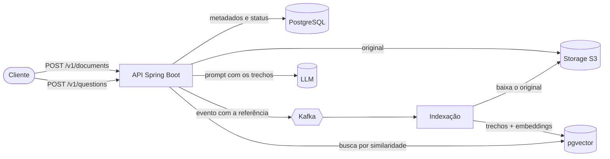

# domain-knowledge-ai

RAG corporativo em Java e Spring Boot: funcionários sobem documentos internos
(políticas, manuais, procedimentos), um pipeline assíncrono com Kafka indexa o
conteúdo, e qualquer pessoa autorizada pergunta em linguagem natural e recebe
a resposta **com as fontes**.

> **Status:** em construção. Fatia 1 de 5 (ingestão) entregue na 0.1.0;
> a próxima é a indexação. Veja o [roadmap](docs/roadmap.md).

## Como funciona



1. **Ingestão:** o upload grava o original no storage, registra o documento
   e publica um evento no Kafka. A API responde na hora com o id e o status.
2. **Indexação:** um consumidor extrai o texto, quebra em trechos, gera
   embeddings e grava no pgvector.
3. **Consulta:** a pergunta vira embedding, os trechos mais parecidos são
   recuperados e o LLM responde só com base neles, citando as fontes.

Detalhes em [docs/arquitetura.md](docs/arquitetura.md); decisões técnicas em
[docs/adr/](docs/adr/).

## Stack

Java 25 · Spring Boot 4.1 · Gradle · Apache Kafka 4 (KRaft) · PostgreSQL 18 +
pgvector · storage S3 (RustFS local) · Flyway · Testcontainers · Gemini (a
partir da fatia 2)

## Como rodar

Pré-requisitos: JDK 25 e Docker com Compose.

```bash
cp .env.example .env          # opcional: sem .env valem os mesmos padrões
docker compose up -d          # PostgreSQL, Kafka e storage S3
./gradlew bootRun             # aplicação em http://localhost:8080
```

| Serviço | Endereço |
| --- | --- |
| Aplicação (health) | http://localhost:8080/actuator/health |
| Console do storage | http://localhost:9001/rustfs/console/ (usuário e senha: `STORAGE_ACCESS_KEY` / `STORAGE_SECRET_KEY` do `.env`) |
| PostgreSQL | `localhost:5432`, banco `dka` |
| Kafka | `localhost:9092` |

### Demo

O roteiro está em [docs/demo.http](docs/demo.http), pra extensão
[REST Client](https://marketplace.visualstudio.com/items?itemName=humao.rest-client)
do VS Code: upload, acompanhamento do status até `INDEXED`, duplicado,
listagem e os erros (tipo não aceito, arquivo vazio, id inexistente). A
segunda parte mostra o Kafka guardando o pedido enquanto a aplicação está
fora do ar.

O corpus da demo são as Comprehensive Rules de Magic: The Gathering
(veja [docs/visao.md](docs/visao.md)). Baixe o PDF e o DOCX em
<https://magic.wizards.com/en/rules> e salve como
`docs/corpus/comprehensive-rules.pdf` e `docs/corpus/comprehensive-rules.docx`
(a pasta fica fora do git).

Pra começar do zero, `docker compose down -v` apaga os dados do banco, do
Kafka e do storage.

Testes (unitários e de integração com Testcontainers):

```bash
./gradlew build
```

## Organização

O projeto segue *Spec-Driven Development*: cada entrega tem spec, plano e
tarefas em [specs/](specs/), e as decisões ficam em ADRs. Veja
[docs/sdd.md](docs/sdd.md).
