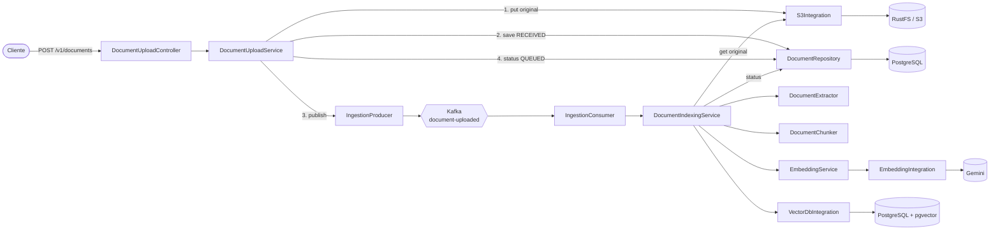
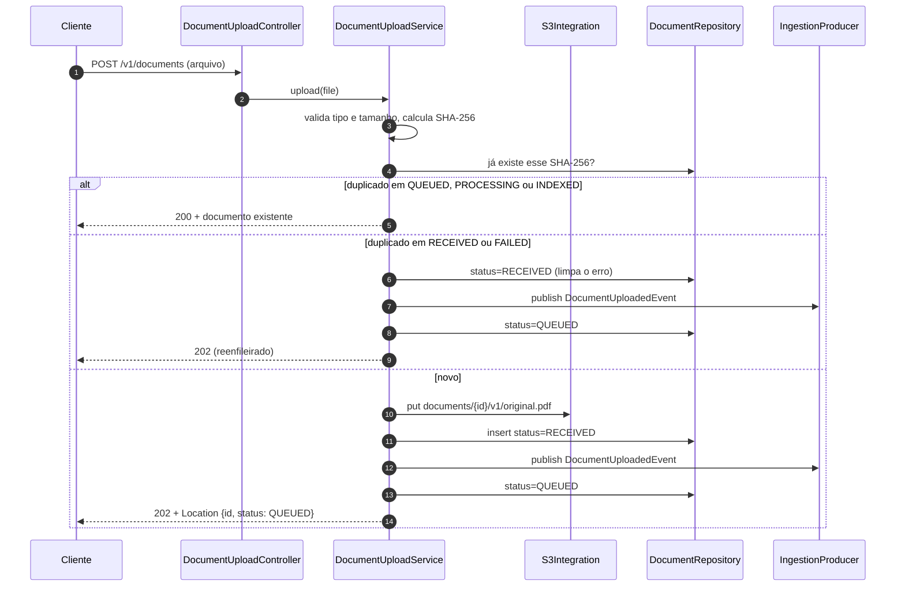
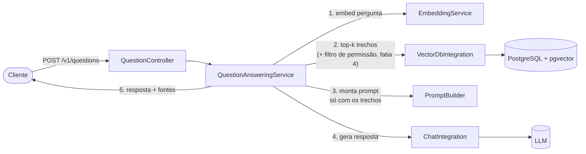
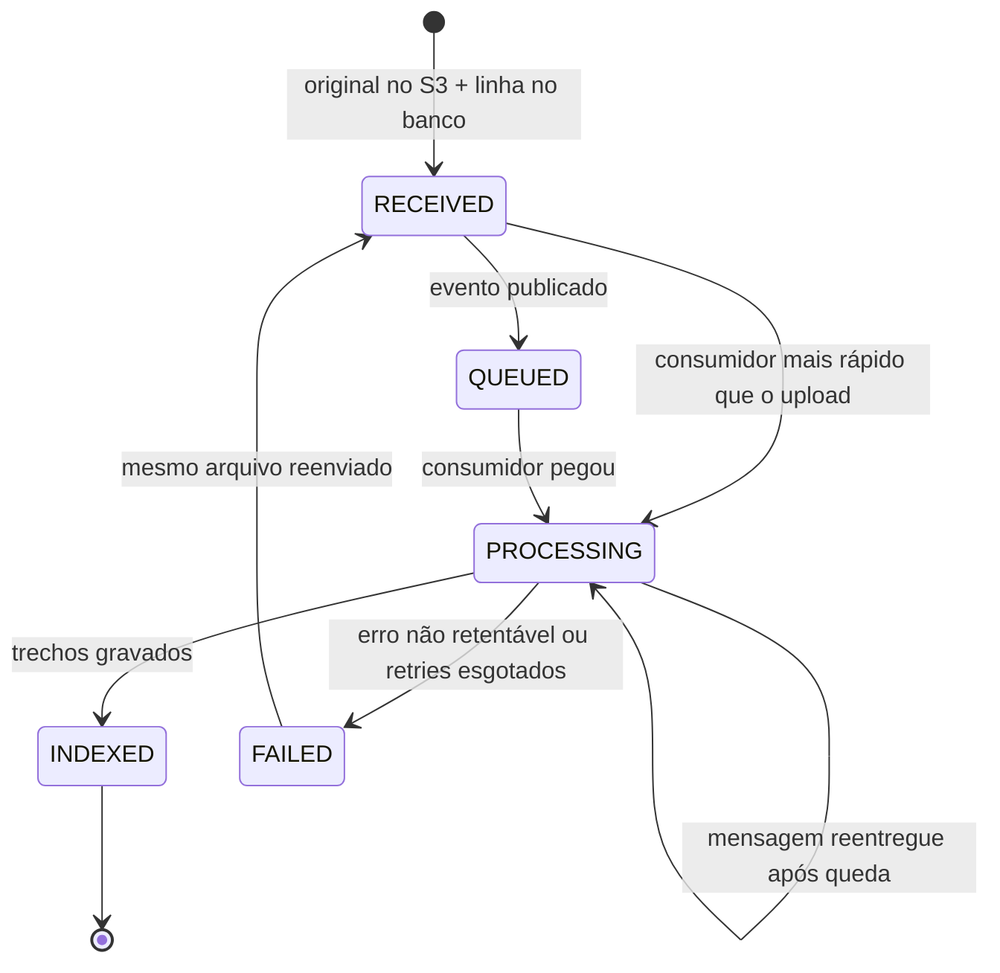

# Arquitetura

As caixas são **responsabilidades lógicas dentro de uma aplicação Spring
Boot** (ADR 0002), não serviços separados. O esboço inicial está em
`docs/diagramas/excalidraw-v0.png`.

## 1. Componentes

| Componente | Lado | Responsabilidade |
| --- | --- | --- |
| `DocumentUploadController` + `DocumentController` | síncrono | `POST /v1/documents` (upload) e `GET /v1/documents` (leitura). Recebem, delegam, traduzem o resultado em HTTP. |
| `DocumentUploadService` | síncrono | Orquestra o upload: valida, calcula o hash, trata duplicado, grava no storage, registra, publica. |
| `IngestionProducer` | síncrono | Só publica o evento no Kafka. Não toca no banco. |
| `IngestionConsumer` | assíncrono | Só recebe o evento e delega. Não toca no banco. |
| `DocumentIndexingService` | assíncrono | Assume o documento, chama extração, chunking, embeddings e gravação dos vetores, marca o resultado. |
| `DocumentExtractor` / `DocumentChunker` | assíncrono | Texto do arquivo / divisão em trechos. Separados pra permitir OCR no futuro. |
| `EmbeddingService` + `EmbeddingIntegration` | assíncrono e consulta | Regra de embedding / adaptador do provedor de IA. |
| `VectorDbIntegration` | assíncrono e consulta | Grava e busca vetores (pgvector, ADR 0003). |
| `S3Integration` | os dois | Grava o original no upload; lê no processamento (ADR 0005). |
| `DocumentRepository` + `DocumentLifecycle` + `DocumentQueryService` | os dois | Metadados e ciclo de vida. O `DocumentLifecycle` é a única porta pra mudar status; o `DocumentQueryService`, pra ler. |
| `QuestionAnsweringService` + `ChatIntegration` | consulta | Busca trechos, monta o prompt, chama o LLM, devolve resposta com fontes (§3). |

Regras que guiam o desenho:

- O arquivo vai pro storage **antes** do evento: o evento leva só a
  referência (ADR 0004).
- Producer e consumer são adaptadores finos; quem muda status é o serviço,
  pelo `DocumentLifecycle`.
- Storage e provedor de IA ficam atrás de uma interface própria; trocar de
  provedor não mexe na regra. O Kafka fica atrás de adaptadores finos
  (`IngestionProducer`, `IngestionConsumer`), sem interface.
- No código, os domínios (`document`, `ingestion`, `indexing`, `query`) ficam
  no primeiro nível dos pacotes, e os clientes de sistemas externos (S3,
  provedor de IA) em `infrastructure/` (ADR 0002; detalhe no plan da
  spec 001 §2).

## 2. Fluxo de ingestão (fatias 1 e 2)



`PostgreSQL` e `PostgreSQL + pgvector` são o **mesmo servidor** (ADR 0003),
desenhados separados só pra mostrar os dois papéis.

### Sequência do upload (síncrono, fatia 1)



## 3. Fluxo de consulta (fatia 3)



Sem trecho acima do limiar de similaridade, a resposta é "não encontrei isso
nos documentos", sem chamar o LLM. Isso evita resposta inventada e economiza
chamada.

## 4. Ciclo de vida do documento



- Cada seta é um `UPDATE` condicional (`WHERE status IN (...)`), feito só
  pelo `DocumentLifecycle`; transição fora do desenho não muda nada.
- Um documento que fica muito tempo em `RECEIVED` é sinal de falha na
  publicação (§6).
- Na fatia 2, gravar os trechos e mudar pra `INDEXED` acontece **na mesma
  transação**, porque metadados e vetores estão no mesmo Postgres
  (ADR 0003). Ou os dois acontecem, ou nenhum.

## 5. Evento Kafka

Tópico `document-uploaded`, chave da
mensagem = `documentId` (garante ordem por documento na mesma partição).

```json
{
  "eventId": "0b6f3c1e-...",
  "eventType": "DOCUMENT_UPLOADED",
  "occurredAt": "2026-11-22T14:03:00Z",
  "documentId": "7d2a...",
  "version": 1,
  "storageKey": "documents/7d2a.../v1/original.pdf",
  "contentType": "application/pdf",
  "sha256": "9f86d08..."
}
```

- `eventId`: pra idempotência e rastreio.
- `sha256`: o consumidor confere se o arquivo que baixou é o mesmo que subiu.
- Sem o conteúdo do arquivo (ADR 0004).

## 6. Riscos conhecidos (registrados, resolvidos depois)

- **Dual write (banco + Kafka):** se o insert der certo e o publish falhar, o
  documento fica `RECEIVED` até o arquivo ser reenviado (RF2). Fatia 1 aceita
  isso e deixa visível. Fatia 4 tira essa dependência com **Transactional
  Outbox** (o evento é gravado numa
  tabela na mesma transação do documento, e um publicador separado manda pro
  Kafka).
- **Timeout não é "não entregue":** quando o producer desiste por timeout,
  a mensagem pode ter chegado ao broker mesmo assim. O upload responde `503`
  e o documento fica `RECEIVED`, mas o consumidor pode receber o evento e
  assumir o documento direto de `RECEIVED` (por isso essa transição existe).
  Visto de verdade no teste do A8, com o Kafka pausado; o outbox da fatia 4
  também resolve isso.
- **Entrega duplicada:** o Kafka garante "pelo menos uma vez". O consumidor
  ignora evento de documento que já está `INDEXED` ou `FAILED` naquela
  versão; em `PROCESSING` ele processa de novo (a aplicação pode ter caído no
  meio), o que é seguro porque os trechos têm id determinístico
  (`documentId:version:index`).
- **Limite do provedor (429):** fatia 4, com backoff e limite de concorrência
  no consumidor.
- **Máquina de desenvolvimento modesta (~8 GB de RAM):** Kafka em modo KRaft com um nó e heap
  limitado, sem Kafka UI nem Zookeeper; detalhe no plan da fatia 1.
